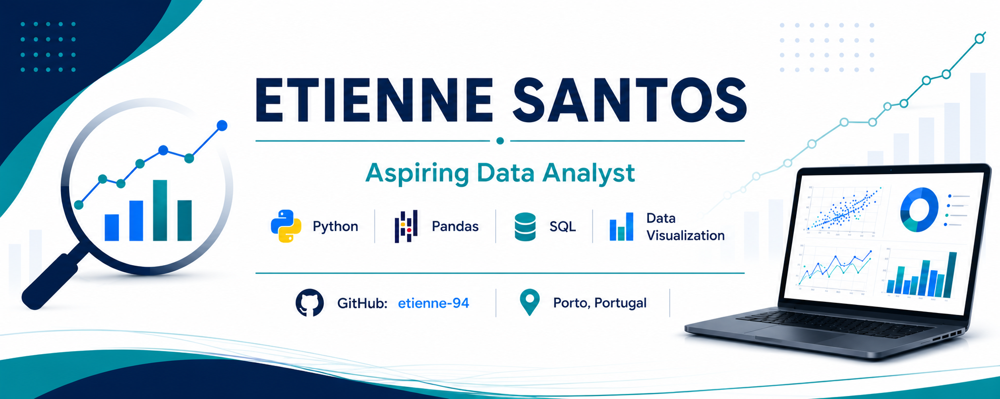

 

  

# Hi, I'm Etienne Santos 👋

### Aspiring Data Analyst | Python | SQL | Business Analytics

## About Me

Aspiring Data Analyst with hands-on experience in data analysis, data cleaning, exploratory data analysis, statistical analysis, and data visualization.

Through the Data Analytics program at TripleTen, I have developed practical skills by working on end-to-end projects involving real-world datasets, transforming raw data into meaningful insights to support data-driven business decisions.

My analytical interests include understanding customer behavior, identifying business trends, evaluating performance, and communicating insights through clear visualizations and interactive applications.

Currently developing my skills in:

- Data Analysis with Python and SQL
- Data Cleaning and Preprocessing
- Exploratory Data Analysis (EDA)
- Statistical Hypothesis Testing
- Customer and Cohort Analysis
- Business and Marketing Analytics
- Data Visualization and Reporting

---

## Featured Projects

### 📊 [Y.Afisha — Marketing, Sales and Business Analysis](https://github.com/etienne-94/y-afisha-marketing-analysis)

End-to-end business analysis of an online entertainment platform, investigating user behavior, sales performance, customer lifetime value, and marketing investment efficiency.

**Key areas:** DAU, WAU, MAU, conversion rates, LTV, CAC, ROMI, cohort analysis, and CAC payback.

**Technologies:** Python, Pandas, NumPy, Matplotlib, Jupyter Notebook.

---

### 🚕 [Chicago Taxi Demand Analysis](https://github.com/etienne-94/chicago-taxi-demand-analysis)

Analysis of Chicago taxi demand to identify temporal patterns, investigate weather-related factors, and test statistical hypotheses.

**Key areas:** SQL queries, data exploration, weather analysis, and statistical hypothesis testing.

**Technologies:** Python, SQL, Pandas, NumPy, SciPy, Matplotlib.

---

### 🎮 [Video Game Sales Analysis](https://github.com/etienne-94/video-game-sales-analysis)

Exploratory and statistical analysis of historical video game sales data to identify market trends and factors associated with commercial success.

**Key areas:** sales trends, regional market analysis, platform performance, and hypothesis testing.

**Technologies:** Python, Pandas, NumPy, Matplotlib, SciPy.

---

### 🚗 [Vehicles App](https://github.com/etienne-94/vehicles-app)

Interactive web application for exploring and visualizing used vehicle sales data through dynamic charts and data-driven insights.

**Technologies:** Python, Pandas, Plotly, Streamlit, Render.

**Live Demo:** [Open Vehicles App](https://vehicles-app-epdt.onrender.com)

---

### 📱 [Megaline Plan Profitability Analysis](https://github.com/etienne-94/megaline-plan-profitability-analysis)

Statistical analysis comparing two prepaid telecom plans to determine which generates higher revenue and offers better business performance.

**Key areas:** revenue analysis, customer behavior, descriptive statistics, and hypothesis testing.

**Technologies:** Python, Pandas, NumPy, Matplotlib, SciPy.

---

### 🛒 [Instacart Customer Behavior Analysis](https://github.com/etienne-94/instacart-customer-behavior-analysis)

Exploratory analysis of customer purchasing behavior using Instacart transaction data.

**Key areas:** data cleaning, preprocessing, order patterns, and customer purchasing behavior.

**Technologies:** Python, Pandas, NumPy, Matplotlib.

---

## Technical Skills

### Programming & Data Analysis
- Python
- SQL
- Pandas
- NumPy
- SciPy

### Data Visualization
- Matplotlib
- Plotly

### Analytics & Statistics
- Exploratory Data Analysis (EDA)
- Statistical Hypothesis Testing
- Cohort Analysis
- Customer Lifetime Value (LTV)
- Customer Acquisition Cost (CAC)
- Marketing Return on Investment (ROMI)

### Development Tools
- Jupyter Notebook
- VS Code
- Git
- GitHub

### Application Development & Deployment
- Streamlit
- Render

---

## Currently Learning

Continuously expanding my knowledge in Data Analytics, strengthening my Python and SQL skills, and developing projects that combine technical analysis with practical business problem-solving.

---

## Contact

- **GitHub:** [github.com/etienne-94](https://github.com/etienne-94)
- **LinkedIn:** [linkedin.com/in/etienneviegassantos](https://www.linkedin.com/in/etienneviegassantos)

---

  <i>Turning data into insights and insights into better decisions.</i>

